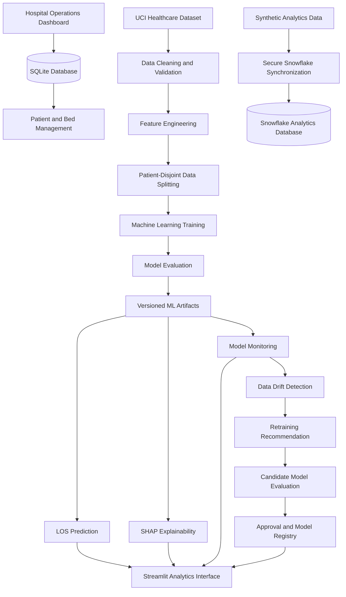

<div align="center">

# 🏥 LOSWatch AI

### Intelligent Hospital Analytics • Machine Learning • MLOps

**An end-to-end healthcare analytics and machine learning system for hospital operations, experimental length-of-stay prediction, model monitoring, and explainable AI.**

[](https://python.org)
[](https://streamlit.io)
[](https://scikit-learn.org)
[](https://snowflake.com)


**[Overview](#-project-overview) • [Features](#-key-features) • [Architecture](#-system-architecture) • [Results](#-machine-learning-performance) • [Installation](#-getting-started)**

</div>

---

## 🌟 Project Overview

**LOSWatch AI** is a healthcare analytics and MLOps project designed to demonstrate how machine learning can support hospital operations research.

It combines hospital record management, historical healthcare data analysis, experimental patient length-of-stay prediction, explainable AI, statistical drift detection, model retraining, and Snowflake data integration.

Unlike traditional machine learning projects that stop after model training, LOSWatch AI explores the complete machine learning lifecycle:

**Data Collection → Preprocessing → Model Training → Evaluation → Prediction → Explainability → Drift Monitoring → Retraining → Model Governance**

The project uses fictional operational records for its hospital dashboard and a separate de-identified public dataset for machine learning research.

> **Disclaimer:** LOSWatch AI is a research and demonstration system, not a medical device or clinically validated decision-support tool. Predictions must not be used for actual patient discharge or treatment decisions.

---

## 📊 Project Highlights

<div align="center">

| 101,766 | 71,518 | 7 | 5 |
|:---:|:---:|:---:|:---:|
| Historical Patient Encounters | Unique Historical Patients | Raw ML Input Features | Snowflake Tables |

</div>

### What makes this project different?

- End-to-end hospital analytics and machine learning workflows.
- Machine learning models evaluated using patient-disjoint data partitions.
- Statistical data drift monitoring with multiple complementary tests.
- Approval-controlled model retraining and rollback.
- SHAP-based explainable predictions.
- Snowflake integration with OAuth authentication.
- Interactive hospital operations and MLOps dashboards.
- Automated tests and reproducible model artifacts.
- Explicit separation between fictional hospital records and historical research data.

---

## 🖥️ Dashboard Preview

### Hospital Operations Dashboard

The interactive Streamlit dashboard provides:

- Patient and admission statistics.
- Bed occupancy monitoring.
- Daily hospital admission trends.
- Doctor and patient management.
- Ward-level bed utilization.
- Experimental LOS prediction.
- Model explainability and drift monitoring.


*Hospital dashboard showing fictional demonstration records.*

---

## 🚀 Key Features

### 1. Hospital Management System

Manage fictional hospital operations through an interactive dashboard.

**Capabilities:**
- Patient profile management.
- Doctor assignments.
- Diagnosis records.
- Medication-order records.
- Admission and discharge tracking.
- Bed allocation and availability.
- Searchable patient histories.
- Validated CRUD operations.

The operational demonstration includes:

- 20 fictional patients.
- 4 fictional doctors.
- 24 hospital beds.
- 15 initially active admissions.

SQLite and SQLAlchemy provide relational data storage, integrity checks, and transaction handling.

### 2. Patient Length-of-Stay Prediction

Predict an experimental estimate of a patient's total hospital length of stay using machine learning.

The model uses seven raw admission-time features:

| Feature | Description |
|---|---|
| Age | Patient age category |
| Gender | Recorded gender |
| Admission type | Emergency, urgent or other admission type |
| Admission source | Source of admission |
| Previous outpatient visits | Outpatient visits during the preceding year |
| Previous emergency visits | Emergency visits during the preceding year |
| Previous inpatient visits | Inpatient visits during the preceding year |

**Algorithms evaluated:**
- Dummy Regressor
- Random Forest Regressor
- HistGradientBoosting Regressor

**Evaluation metrics:**
- Mean Absolute Error (MAE)
- Root Mean Squared Error (RMSE)
- R² Score

The selected model is chosen using validation MAE rather than test-set performance.

### 3. Real Healthcare Dataset Analysis

The ML pipeline uses the publicly available:

**Diabetes 130-US Hospitals for Years 1999–2008 Dataset**

Source: [UCI Machine Learning Repository](https://archive.ics.uci.edu/dataset/296/diabetes+130+us+hospitals+for+years+1999+2008)

Dataset characteristics:

- 101,766 hospital encounters.
- 71,518 distinct patients.
- Historical US inpatient records.
- Diabetes-related admissions.
- Recorded admission characteristics and hospital outcomes.

The application includes a separate read-only historical records explorer.

Users can inspect:
- Recorded diagnoses.
- Medication indicators.
- Admission information.
- Actual hospital length of stay.
- Recorded discharge outcomes.

No patient names, doctor assignments, or bed assignments are invented for this historical dataset.

### 4. Data Drift Monitoring

Machine learning models can become less reliable when incoming data differs from training data.

LOSWatch AI implements statistical monitoring to identify these changes.

**Implemented techniques:**

| Technique | Purpose |
|---|---|
| Kolmogorov-Smirnov Test | Detect numerical distribution changes |
| Population Stability Index | Measure distribution shift |
| KL Divergence | Compare probability distributions |
| Wasserstein Distance | Quantify numerical distribution differences |
| Chi-Square Test | Test categorical distribution changes |

Additional functionality includes:
- Missing-value monitoring.
- Unseen-category detection.
- Statistical alerts.
- Feature-level drift reports.
- Reproducible drift simulations.
- Versioned monitoring reports.

Simulated drift scenarios are explicitly separated from operational monitoring signals.

### 5. Model Retraining and Governance

LOSWatch AI implements a controlled machine learning retraining workflow.

**Features:**
- Monitor model prediction errors.
- Detect model-performance degradation.
- Generate retraining recommendations.
- Train candidate models.
- Compare candidate and active models.
- Evaluate models using consistent validation data.
- Require approval before promotion.
- Maintain model versions.
- Support model rollback.
- Record audit events.

**Safety mechanisms:**
- Patient-disjoint training and validation partitions.
- Original test holdout excluded from retraining.
- Rejection of invalid labels and patient identities.
- No automatic deployment of weak candidates.
- Explicit approval before model promotion.
- No overwriting of existing model artifacts.

The workflow demonstrates core MLOps concepts without requiring AWS.

### 6. Explainable AI Using SHAP

Machine learning predictions should be understandable rather than treated as unexplained outputs.

LOSWatch AI implements SHAP-based explanations for the active prediction model.

**Features:**
- Patient-level feature contributions.
- Global feature importance.
- Visualization of positive and negative contributions.
- Model artifact identification.
- Prediction reconstruction checks.
- Downloadable explanation reports.

SHAP explains how model features are associated with predictions.

It does not establish causal medical relationships.

### 7. Snowflake Data Integration

LOSWatch AI integrates with Snowflake for optional cloud-based analytics storage.

**Implemented capabilities:**
- Secure OAuth authorization-code authentication.
- Restricted application role.
- Connection health checks.
- Dedicated analytics database and schema.
- Versioned monitoring and model records.
- Synthetic data synchronization.
- Parameterized SQL operations.
- Duplicate-safe synchronization.
- Query-back record verification.

**Snowflake environment:**

| Component | Configuration |
|---|---|
| Database | `LOSWATCH_AI` |
| Schema | `MONITORING` |
| Application role | `LOSWATCH_APP` |
| Authentication | OAuth Authorization Code |
| Warehouse | Existing Snowflake warehouse |

The operational SQLite database remains independent of Snowflake.

Only explicitly approved synthetic demonstration payloads are synchronized through the demo workflow.

### 8. Interactive Analytics Dashboard

The application provides a professional Streamlit interface with:

- Hospital overview KPI cards.
- Admissions charts.
- Ward-level bed occupancy.
- Patient and doctor management.
- Historical encounter exploration.
- LOS prediction forms.
- SHAP explanation visualizations.
- Data drift monitoring.
- Model retraining controls.
- Snowflake integration status.

The dashboard uses a consistent design system, responsive layouts, and Plotly visualizations.

---

## 🏗️ System Architecture



### Architecture Principles

**Separation of concerns:** Operational records, historical research data, and model artifacts are stored separately.

**Reproducibility:** Model experiments preserve data splits, metrics, configurations, and artifact checksums.

**Security:** Snowflake uses a restricted application role and explicitly initiated synchronization.

**Governance:** Model promotion requires approval, and rollback actions are audited.

**Local-first design:** The core project works without cloud infrastructure.

---

## 🛠️ Technology Stack

| Category | Technologies |
|---|---|
| Programming | Python |
| Data Analysis | Pandas, NumPy |
| Machine Learning | Scikit-learn |
| Algorithms | Random Forest, HistGradientBoosting |
| Explainable AI | SHAP |
| Statistical Monitoring | SciPy, KS Test, PSI, KL Divergence, Wasserstein |
| Frontend | Streamlit |
| Visualization | Plotly |
| Operational Database | SQLite |
| ORM | SQLAlchemy |
| Cloud Analytics | Snowflake |
| Testing | Pytest |
| Version Control | Git, GitHub |

---

## 📈 Machine Learning Performance

### Model Comparison — Phase 2.1

The revised ML workflow corrected age parsing, improved feature engineering, and compared multiple candidate models.

| Model | Test MAE ↓ | Test RMSE ↓ | Test R² ↑ |
|---|---:|---:|---:|
| Dummy Regressor | 2.2542 | 2.9933 | -0.0173 |
| **Random Forest** | **2.2007** | 2.9972 | -0.0200 |
| HistGradientBoosting | 2.2005 | 3.0253 | -0.0392 |

**Selected model:** Random Forest Regressor

**Selection criterion:** Lowest validation MAE.

### Performance Improvement

The selected Random Forest reduced test MAE by approximately **2.37%** compared with the previous median baseline.

However, the model still has important limitations.

- Test R² remains negative.
- Predictive signal from admission-only features is weak.
- Long hospital stays are substantially underpredicted.
- The historical dataset does not establish performance for modern hospitals.

For actual 8–14-day stays, validation analysis found an average underprediction of approximately **6.12 days**.

These findings are reported transparently rather than presenting the model as clinically accurate.

---

## 🔬 Machine Learning Methodology

### Data Processing

1. Load the historical UCI dataset.
2. Validate encounter and patient identifiers.
3. Handle missing and invalid values.
4. Engineer admission-time features.
5. Separate patients into training, validation, and test groups.
6. Fit preprocessing only on training data.
7. Train baseline and candidate models.
8. Select models using validation metrics.
9. Evaluate frozen models on the preserved test partition.
10. Save models, metrics, and artifact manifests.

### Data Leakage Prevention

The prediction model intentionally excludes information that may only become available during or after hospitalization.

Excluded information includes:
- Actual length of stay.
- Discharge disposition.
- Readmission outcome.
- Laboratory results collected during the stay.
- Medication changes during hospitalization.
- Diagnoses not established as admission-time inputs.
- Patient and encounter identifiers.

The saved patient-disjoint partitions reduce patient-identity leakage across evaluation datasets.

---

## ⚙️ Getting Started

### Prerequisites

- Python 3.11 or later.
- Git.
- VS Code or another Python IDE.
- Internet connection for the initial UCI dataset download.
- Optional Snowflake account for cloud analytics.

### 1. Clone the Repository

```bash
git clone https://github.com/SWAPNA2301/LOSWatch-AI.git
cd LOSWatch-AI
```

### 2. Create a Virtual Environment

```bash
python -m venv .venv
```

Activate on Windows:

```powershell
.\.venv\Scripts\Activate.ps1
```

On macOS/Linux:

```bash
source .venv/bin/activate
```

### 3. Install Dependencies

```bash
python -m pip install -r requirements.txt
```

For machine learning workflows:

```bash
python -m pip install -r requirements-ml.txt
```

### 4. Initialize Fictional Hospital Records

```bash
python -m loswatch.seed
```

This creates the local fictional demonstration data.

### 5. Launch the Dashboard

```bash
python -m streamlit run app.py
```

Open:

**http://localhost:8501**

If the port is occupied, Streamlit may use another available port.

### 6. Train Machine Learning Models

Initial experiment:

```bash
python -m loswatch.ml.train
```

Audited Phase 2.1 workflow:

```bash
python -m loswatch.ml.phase21 develop
python -m loswatch.ml.phase21 evaluate
```

Model artifacts are saved in versioned local directories.

Existing experiment outputs are protected from accidental overwriting.

### 7. Run Automated Tests

```bash
python -m pytest -q
```

The Phase 8 development workflow reported 93 passing automated tests.

Test counts may change as additional functionality is added.

---

## ❄️ Optional Snowflake Setup

Install Snowflake dependencies:

```bash
python -m pip install -r requirements-snowflake.txt
```

Copy the configuration template:

```powershell
Copy-Item .env.example .env
```

Configure the following environment variables locally:

```dotenv
LOSWATCH_SNOWFLAKE_ACCOUNT=your-org-account
LOSWATCH_SNOWFLAKE_USER=your-snowflake-user
LOSWATCH_SNOWFLAKE_AUTHENTICATOR=OAUTH_AUTHORIZATION_CODE
LOSWATCH_SNOWFLAKE_DATABASE=LOSWATCH_AI
LOSWATCH_SNOWFLAKE_SCHEMA=MONITORING
LOSWATCH_SNOWFLAKE_WAREHOUSE=your-existing-warehouse
LOSWATCH_SNOWFLAKE_ROLE=LOSWATCH_APP
```

Do not commit `.env` or authentication credentials.

Review the SQL files in `sql/` before initializing the Snowflake schema.

Snowflake initialization and synthetic synchronization require explicit user confirmation.

---

## 📁 Project Structure

```text
LOSWatch-AI/
│
├── app.py
├── README.md
├── requirements.txt
├── requirements-ml.txt
├── requirements-snowflake.txt
├── pytest.ini
├── .env.example
│
├── loswatch/
│   ├── database.py
│   ├── models.py
│   ├── services.py
│   ├── seed.py
│   ├── ui.py
│   ├── ui_theme.py
│   ├── history.py
│   ├── history_ui.py
│   ├── prediction.py
│   ├── prediction_ui.py
│   ├── drift.py
│   ├── drift_ui.py
│   ├── retraining.py
│   ├── retraining_ui.py
│   ├── explainability.py
│   ├── explainability_ui.py
│   ├── snowflake.py
│   ├── snowflake_ui.py
│   └── ml/
│
├── sql/
│   ├── snowflake_admin_setup.sql
│   └── snowflake_schema.sql
│
├── tests/
├── data/
├── artifacts/
└── .streamlit/
```

Raw datasets, model artifacts, local databases, and credentials should remain excluded from version control.

---

## 🔐 Security and Responsible AI

LOSWatch AI incorporates several engineering safeguards:

- Fictional operational data.
- Separate de-identified historical research data.
- Foreign-key and database integrity constraints.
- Patient-disjoint ML evaluation.
- Admission-time feature restrictions.
- Protected model artifacts.
- Approval-controlled model promotion.
- Audited rollback operations.
- Restricted Snowflake permissions.
- Synthetic-only demonstration synchronization.
- Explicit model limitation disclosures.

### Important Limitations

This is a local research prototype.

It does not currently provide production-grade:
- Hospital user authentication.
- Clinical authorization controls.
- Comprehensive patient privacy compliance.
- Production monitoring infrastructure.
- Clinically validated discharge predictions.

**Never upload real patient-identifiable information or use experimental LOS predictions for actual medical decisions.**

---

## 🗺️ Development Roadmap

| Phase | Feature | Status |
|---|---|---|
| Phase 1 | Hospital Operations Management | ✅ Complete |
| Phase 2 | Historical Data and ML Training | ✅ Complete |
| Phase 2.1 | Feature Engineering and Model Evaluation | ✅ Complete |
| Phase 3 | Experimental LOS Prediction | ✅ Complete |
| Phase 4 | Statistical Data Drift Monitoring | ✅ Complete |
| Phase 5 | Retraining and Model Governance | ✅ Complete |
| Phase 6 | Explainable AI with SHAP | ✅ Complete |
| Phase 7 | Optional Snowflake Integration | ✅ Implemented |
| Phase 8 | Professional Streamlit Dashboard | ✅ Implemented |
| Phase 9 | Final Evaluation and Documentation | 🔄 In Progress |

---

## 🎯 Key Learning Outcomes

Building LOSWatch AI demonstrates practical experience with:

- End-to-end machine learning development.
- Healthcare dataset exploration and preprocessing.
- Feature engineering and leakage prevention.
- Baseline comparison and model selection.
- Regression evaluation and error analysis.
- Statistical hypothesis testing.
- Data drift detection.
- Explainable AI.
- Model versioning and governance.
- Database design and SQL.
- Snowflake cloud analytics integration.
- Interactive analytical dashboard development.
- Software testing and reproducibility.

---

## 📚 Dataset Attribution

**Diabetes 130-US Hospitals for Years 1999–2008**

Clore, Cios, DeShazo & Strack (2014).

UCI Machine Learning Repository.

[Dataset Link](https://archive.ics.uci.edu/dataset/296/diabetes+130+us+hospitals+for+years+1999+2008)

[DOI: 10.24432/C5230J](https://doi.org/10.24432/C5230J)

Dataset license: CC BY 4.0.

---

## 👩‍💻 Author

**Swapna Pal Chowdhury**

B.Tech — Information Technology

Aspiring Data Scientist | Machine Learning & Data Analytics

**GitHub:** [SWAPNA2301](https://github.com/SWAPNA2301)

---

<div align="center">

### Built to demonstrate more than model training.

**LOSWatch AI brings together data science, analytics, explainability, and responsible MLOps in one integrated research project.**

⭐ If you find this project interesting, consider starring the repository!

</div>
